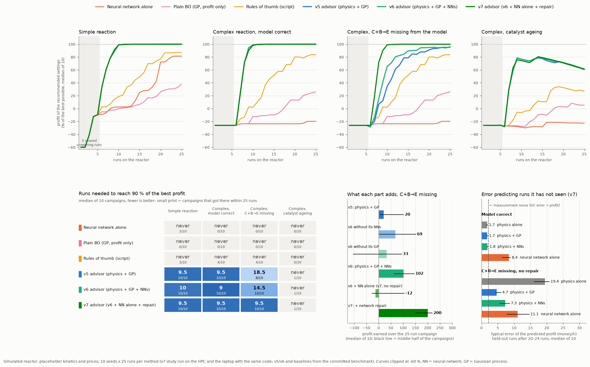
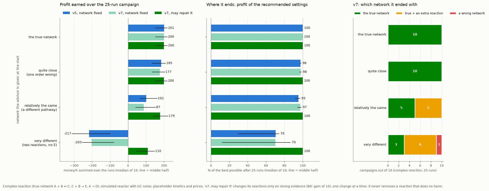

# ACOD310 — Smart optimisation of a catalytic fixed-bed reactor

Team: Sumant Varanasi & Parva Chaudhary. Supervisors: Prof. Rachit Khare, Prof. Rahul Singh.
Project plan: the Google Doc linked in `gDoc-link`. Reactor model: `digital-twin-fixed-bed-reactor.md`
(Prof. Khare's formulation) and `smart-advisor-model.md` (what the advisor adds).

**What this is.** A digital twin of the Micromeritics gas-phase fixed-bed reactor, and a study of
how to find its best operating point in as few experiments as possible. It grew in stages:
a packed-bed twin with a first Bayesian optimiser (v1), a properly benchmarked Bayesian-optimisation
package (v2), a **physics-informed advisor** that learns the reaction kinetics from the GC
readings and tells an operator what to run next, in plain English, through a web page (v3/v4),
a learning upgrade (v5) that adds product inhibition and catalyst ageing only when the data
support them, plans several runs ahead, and respects product specs, and a committee correction
(v6) in which a Gaussian process and an ensemble of small neural networks both correct the
physics, each trusted by how well it predicts runs it has not seen. v7 adds a neural network that
predicts profit from the knobs alone as a fourth member of that committee, a reaction finder that
works out from a GC log which reactions happen, and an advisor that uses it to check its own
reaction network after every run and repair it when the GC readings disagree.

**Headline result** (simulated reactor, placeholder kinetics and prices, 10 campaigns of 25 runs):
the advisor reaches 90 % of the best possible profit in a median of **9–10 runs**, against **21 or
more** for a scripted rules-of-thumb policy and **more than 25** for black-box Bayesian
optimisation (only 2 of its 20 campaigns got there at all), on both a simple and a complex reaction
network, under the real operating protocol (catalyst loaded once, step limits between runs, five
shared screening runs). These are the v4 numbers (section 3.5). The v5 benchmark (170 campaigns,
section 3.6) reaches the best point in 10 of 10 campaigns on the complex reactor and earns more
along the way than v4 in 8 of 10. v6 (section 3.7) matches v5 when the chemistry is right and,
with a reaction missing from its model, is at 65 % of the best profit after 10 runs instead of
34 % and earns more in 8 of 10 campaigns (p = 0.014).
v7 (section 3.8) matches v6 when its reaction network is right; when a reaction is missing from its model it puts it back by run 6 (median) in 10 of 10 campaigns and earns about twice as much as v6 over 25 runs (200 against 102, more in 10 of 10, p = 0.002). A neural network on its own never reaches 90 % of the best profit on the complex reaction.

> **Status (25 November 2026).** v7 is built, reviewed and benchmarked (320 campaigns, section 3.8)
> and is now the default on the web page and the command line; v6 is one setting away (*Advisor
> version* on the page, `--advisor v6`) and is tagged `v6`, v5 is tagged `v5`. The mid-term presentation (17 October) is in `presentation/`. The figures and
> `results/smart_demo_summary.md` still show the v4 benchmark; `python khare_demo.py` rebuilds them
> from the finished v5 benchmark cache.

> Every kinetic parameter, price and noise level in this repository is a **placeholder**. The
> numbers and figures will change once the real kinetics and prices are agreed with Prof. Khare
> and a real GC log is available.

---

## 1. Quick start

```bash
pip install -r requirements.txt        # numpy, scipy, matplotlib, scikit-learn
python reactor_ui.py                   # the web interface: opens http://localhost:8765
python khare_demo.py                   # the evidence: 4-part demo; first run ~2.5 h on 10 cores, then cached
python reactor_advisor.py --demo       # the same advisor on the command line (writes demo_log.csv)
```

Run everything from inside the repo folder. Python 3.10+ (developed on 3.14, Windows 11).
Outputs go to `figures/` (committed) and `results/` (git-ignored, regenerated by the scripts).

To check the installation:

```bash
python test_reactor_twin.py            # 11 checks, 1 s
python test_reactor_ui.py              # 56 checks, ~5 min
python test_smart.py                   # 132 checks, ~8 min
python test_discovery.py               # 81 checks, ~8 min
python test_pareto.py                  # 58 checks, ~1 min
python test_bo.py                      # 29 checks, ~5 min
```

---

## 2. The stages

| Stage | What it is | What it showed | Scripts |
|---|---|---|---|
| **v1 — twin + basic BO** | Packed-bed mole balances for A + B → C, A → D; a hand-written Gaussian-process optimiser with Expected Improvement over 5 knobs; brute-force comparison. | BO reached yield ≥ 0.99 in 17 experiments where random search needed 285 (one seed; over 10 seeds the gap is 22 vs ~104). Yield turned out to be too easy an objective: a broad plateau. | `reactor_twin.py`, `sweeps.py`, `bo_basic.py`, `bo_5knobs.py`, `simulation_campaign.py`, `compare.py` |
| **v2 — BO package and benchmark** | `bo/`: fitted Matérn GP, four acquisition functions, batch mode, a neural-network surrogate, constrained BO, a harder profit objective, 20-seed benchmark with significance tests. | BO beats random, Latin-hypercube and Nelder–Mead (p < 0.001); constrained BO is essential when there is a product spec; ~25 % of plain-BO runs get stuck in a second optimum on the profit objective. | `bo/`, `run_benchmark.py`, `analyse_benchmark.py`, `surrogate_study.py`, `suggest_next.py`, `make_report.py` |
| **v3/v4 — smart advisor + web UI** | `smart/`: the advisor knows the reactor physics, learns the kinetics from every GC reading, plans where the best profit is and walks there within the step limits a real reactor allows. A scripted rules-of-thumb baseline. A web page and a command-line tool for the operator. | Under the real protocol the advisor is 2–3× faster than the scripted rules-of-thumb policy to 90 % of the best profit, and black-box BO cannot plan beyond one step. It still works with one reaction missing from its model. | `smart/`, `reactor_ui.py` + `ui/`, `reactor_advisor.py`, `khare_demo.py` |
| **v5 — learning upgrade** | A ladder of kinetic models (plain → product inhibition → its adsorption heat → catalyst ageing) chosen by BIC; a receding-horizon planner that values the runs left; product and safety specs; a catalyst-ageing scenario with check runs; trust-region and GP-ensemble strategies in `bo/`. | Learned activation energies within 1 kJ/mol of the truth (the plain model missed one by 15). On the complex reactor v5 reaches the best point in 10/10 campaigns and earns more on the way than v4 in 8/10. Ageing is detected and reported, not solved. The new `bo/` strategies give no significant gain over GP + EI. | `smart/kinetics.py`, `smart/advisor.py`, `smart/benchmark.py`, `bo/` |
| **v6 — committee correction** | The correction of the physics is a committee: no correction, the v5 Gaussian process, and an ensemble of 8 small neural networks that also see the physics prediction, weighted after every run by how well each predicts held-out runs (stacking); their disagreement adds to the uncertainty. | Same as v5 when the chemistry is right. With C + B → E missing: 65 % vs 34 % of the best profit after 10 runs, 90 % reached 4 runs sooner, more profit earned in 8/10 campaigns (p = 0.014). The GP carries most of the weight; the networks 5–10 %. | `smart/committee.py`, `compare_v6.py` |
| **v7 — a neural network alone in the committee, network repair, reaction finder** | A fourth committee member: an ensemble of small neural networks that predicts profit from the knobs alone (no physics), weighted by held-out prediction like the others. After every run the advisor checks whether its reaction network explains the GC readings and, if not, changes it one step at a time, only on strong evidence. A reaction finder that works out which reactions happen from a GC log (automatic search, or ranking of typed candidate networks) and proposes the run that would tell two networks apart. An optional profit vs selectivity trade-off curve. | Reaction finder (simulated data, placeholder kinetics): recovers a network that is not one of the built-in ones (A + B ⇌ C, C → D + B, A + 2 B → E) from 30 noisy runs; ranks four typed candidates with the true network first on every complex example file (typical miss 0.75, 7, 25 and 69 times the GC noise on `complex_noisy.csv`); finds the site blocking on the "real"-reactor file and a zero-order rate law; on the first 8 runs of 10 step-limited campaigns it found the true network in 6 and reported the other 4 as not fitting. Advisor (10 seeds × 25 runs): the same as v6 when the network is right; with C + B → E missing it repairs the network by run 6 and earns 200 against v6's 102 (10/10, p = 0.002); from a wrong starting network the repair earns more than the same advisor with its network fixed in 30 of 30 campaigns. The stand-alone network does not help (with a reaction missing and no repair it costs a little), and on its own it never reaches 90 % on the complex reaction. | `smart/discovery.py`, `smart/committee.py`, `smart/advisor.py`, `smart/pareto.py`, `discover_reactions.py`, `analysis_v7/` |

Sections 3–5 describe the advisor (the current work, v3–v7); sections 6–7 keep the v2 and v1
material, which still runs unchanged.

---

## 3. The smart reactor advisor

### 3.1 The problem it solves

Someone runs a small catalytic fixed-bed reactor (a lab, a pilot plant, a small chemicals business)
and wants it to make more money. Every run costs a day, feed gas and reactor time, so they can
afford perhaps 10–25 runs, and they do not know kinetics or machine learning. Today they tune by
rules of thumb. The advisor takes the run log they already keep (set points + GC printout) and
tells them what to run next, why, what profit to expect, where this is heading and whether another
run is worth its cost.

### 3.2 It follows the real operating protocol

Details in `smart-advisor-model.md`.

- The **catalyst is loaded once**; its mass and BET surface area are campaign settings, never a
  suggestion (changing the bed means shutting down and repacking).
- **Five knobs** can change between runs: pressure, the flows of A, B **and the inert**, and
  temperature. The inert is a real knob: it dilutes the feed and lowers every partial pressure.
- **Step limits.** No knob may change more than a set amount between consecutive runs (defaults
  10 bar, 10 mL/min per flow, 30 K; configurable), so every suggestion is viable on the hardware.
- The GC needs ≥ 10 mL/min of total feed and ≥ 2 mL/min of inert (the internal standard).
- The bed is integrated over the **catalyst surface area** S = a_BET · W_cat with rates per m², so
  the learned kinetics are properties of the catalyst material and carry over to another loading
  or batch (checked: 0.5 g at 200 m²/g gives the same outlet as 1 g at 100 m²/g).
- Every campaign starts with the **same 5 screening runs** an operator would do (a temperature
  ladder, then pressure up, then more B); from run 6 on the method chooses.

### 3.3 Why it is "smart": it knows the physics and learns only what it does not know

Plain BO sees **one number per run** (profit) and learns the landscape from scratch; under step
limits it cannot see further than one step. The advisor sees the **full GC composition** and
reasons with a reactor model:

| Built in (physics) | Learned from the runs |
|---|---|
| reaction network and stoichiometry, mole balances over the catalyst surface | rate constant of every reaction (v7: also a change of the reaction network, when the GC readings demand one) |
| Arrhenius temperature dependence, ideal-gas partial pressures (inert dilution included) | activation energy of every reaction |
| equilibrium limit from thermodynamics (ΔH, ΔS) | a correction for whatever the physics misses (v5: a Gaussian process; v6: a committee of a GP and neural networks; v7: the same plus a neural network alone) |
| economics (prices) | |

Each round (v5; details in `smart-advisor-model.md` section 8):

1. **Fit the chemistry** to every GC mole fraction (Bayesian least squares with a wide prior,
   `smart/kinetics.py`). A ladder of model classes is fitted: plain kinetics, then product
   inhibition (Langmuir–Hinshelwood site blocking), then its adsorption heat, then catalyst
   ageing over time on stream. The data choose by BIC with the GC's own noise; ageing is only
   tried when a set point has been repeated (a check run), because only a repeat can tell drift
   from kinetics.
2. **Keep alternatives**: the best fit plus posterior draws, with the uncertainty inflated when
   the physics fits worse than the GC noise explains.
3. **Plan**: predict profit over the whole box, find where the model expects the best profit and
   how many allowed steps away it is.
4. **Correct**: a GP on the residual (measured − physics) with a noise floor from the GC error,
   so noise is never mistaken for chemistry; the spread is calibrated against the advisor's own
   past misses. In v6 this step is a weighted committee (section 3.7); v7 adds a fourth member
   to it and, between steps 1 and 2, checks and if needed repairs the reaction network (section 3.8).
5. **Decide** with a receding-horizon planner: from a shortlist of allowed first steps, roll
   forward up to four runs and score each path under every plausible chemistry by the profit
   earned on the way plus what the best point found is worth for the runs left. With a product
   spec, only steps likely to meet it count; when none can, it takes the step most likely to get
   back within spec ("recover").

The v4 rule (one-step Expected Improvement plus a purposeful step toward the predicted best) is
kept as `planner="greedy"` and benchmarked as `smart_v4`.

The physics is **deliberately imperfect**: the virtual reactor used for testing has product
inhibition with a reactant-adsorption term the advisor never has, 1 % GC noise and, in the ageing
scenario, severity-dependent catalyst decay that the advisor can only approximate by a constant
rate, as any textbook model differs from a real reactor. A stress test also removes a whole
reaction (C + B → E) from the advisor's model.

### 3.4 Two chemistries

| | Simple (the project's network) | Complex |
|---|---|---|
| reactions | A + B → C, A → D | A + B ⇌ C (reversible, exothermic), C + B → E (over-reaction), A → D (cracking) |
| unknowns learned | 2 rate constants, 2 activation energies | 3 and 3 |
| best possible profit at 1 g, v4 virtual reactor | 28.8 /h at 97 bar, 50/49/2 mL/min, 624 K | 22.4 /h at 43 bar, 50/49/2 mL/min, 529 K |
| best possible profit at 1 g, v5 virtual reactor | 27.1 /h at 81 bar, 50/49/2 mL/min, 611 K | 18.5 /h at 30 bar, 50/48/2 mL/min, 550 K |
| temperature window keeping ≥ 90 % of best profit (v4) | 72 K | 32 K |
| share of the operating box that makes any profit (v4 / v5) | 5.5 % / 4.5 % | 2.0 % / 1.0 % |

On the complex network everything competes: hotter is faster but the equilibrium and the cracking
take product away; more B converts more A but the over-reaction eats the product; pressure helps
the equilibrium but costs compression; inert dilutes everything. The profitable window is narrow
(`figures/smart_1_operating_window.png`). The v5 virtual reactor adds reactant adsorption to the
inhibition, which moves the optimum (row above); scores are always relative to the reactor used.

### 3.5 Results of the v4 advisor

From `python khare_demo.py` (run on 15 October, before v5): 10 campaigns per method and chemistry, each from a different
plausible base case, 25 runs each (five weeks at one run per day). All methods see the same
virtual reactor, the same GC noise and the **same 5 screening runs**; from run 6 on each
proposes runs within the step limits. Score = **true** profit of the settings each method
would recommend, as % of the best possible profit at that catalyst loading.

| Chemistry | Method | after 10 runs | after 15 | after 25 | runs to reach 90 % |
|---|---|---|---|---|---|
| simple | **Smart advisor** (physics + GP) | **93 %** | **95 %** | 96 % | **9.5** (10/10 campaigns) |
| simple | Rules of thumb (scripted) | 21 % | 74 % | 96 % | 21 (7/10) |
| simple | Plain BO (GP + EI, profit only) | 2 % | 15 % | 40 % | > 25 (2/10) |
| simple | Random walk | −8 % | −6 % | −6 % | > 25 (0/10) |
| complex | **Smart advisor** (physics + GP) | **99 %** | **98 %** | **97 %** | **9** (10/10) |
| complex | Rules of thumb (scripted policy) | 8 % | 61 % | 87 % | > 25 (4/10) |
| complex | Plain BO (GP + EI, profit only) | −8 % | 6 % | 25 % | > 25 (0/10) |
| complex | Random walk | −20 % | −20 % | −20 % | > 25 (0/10) |
| complex | Smart advisor, **C + B → E missing from its model** | 62 % | 95 % | 99 % | 12 (10/10) |

- **The rules of thumb get there too, given enough runs**: after 25 runs the rules of thumb reach
  96 % (simple) and 87 % (complex). After 25 runs smart and the rules of thumb are tied on the simple
  reaction (5/10 paired campaigns, p = 0.92); on the complex one smart is still ahead (9/10,
  p = 0.004).
- **The advisor's value is speed.** It reaches 90 % of the best profit in a median of 9.5 runs
  (simple) and 9 runs (complex), against 21 and "not within 25" for the rules of thumb. After 10 and 15
  runs it beats the rules of thumb in **10/10 paired campaigns** on both chemistries (Wilcoxon
  p = 0.002). Each run saved is a day of reactor time, feed gas and operator time.
- **Why it is faster**: it learns each reaction's temperature response from the screening ladder
  alone (full GC composition, not one profit number), predicts where the best profit is over the
  whole box, and walks there one allowed step at a time; the rules of thumb probe a knob or two per run;
  plain BO, which sees only profit, cannot plan beyond one step.
- **Wrong network.** With the over-reaction removed from its model the advisor is slower (62 %
  after 10, 95 % after 15) but still ends at 99 %: the GP correction learns the missing product loss.
- **What it learned** (live run, complex, 15 runs, 517–625 K covered): the ordering of the
  activation energies (side reactions higher than the main one) comes out right, which is what
  decides the best temperature; the absolute values are biased high by ~30 kJ/mol because the fit
  absorbs the product inhibition the model lacks. Recommended settings within 2 % of the best
  possible.
- **Operator view** (`reactor_advisor.py --demo --simulate-days 10`): the screening runs made
  1.2 /h at best; day 1 is a planned stepping stone, day 5 reaches the optimum (25.4 /h measured,
  above the true best of 22.4 because of GC noise), and on day 10 the tool says the remaining gain
  is under 2 % of the current profit, so another run is not worth it.

Figures: `figures/smart_1_operating_window.png` (margin for error at 1 g), `smart_2_progress.png`
(profit vs runs, shared screening band), `smart_3_runs_needed.png`, `smart_4_learned_chemistry.png`
(learned vs true Arrhenius lines; GC parity). Tables: `results/smart_demo_summary.md` (rebuilt by
the demo). The 90 campaigns take about 200 CPU-minutes in all: ~10 min of wall time on 20 cores,
~50 min on 4, ~100 min on 2 (the benchmark uses `cpu_count − 2` processes; `--workers N` changes
that, `--seeds 5` halves the work). They are cached in `results/smart_bench/`, one file per
campaign and budget (git-ignored, so a fresh clone builds them once); the demo then reruns in
under a minute. Delete `results/smart_bench/*/smart*.npz` after changing the advisor.

### 3.6 Results of the v5 advisor

`smart/benchmark.py` ran 170 campaigns (25 runs each, 10 seeds) in three scenarios: `simple`,
`complex`, and `complex_deact` (the complex reactor with a catalyst losing about 2 % activity per
day, the base case repeated as a check run every 5th run). Methods: v5, v4, the rules of thumb,
plain BO, random walk, and v5 with C + B → E missing. The cache is in `results/smart_bench/`;
`python khare_demo.py` turns it into figures and `results/smart_demo_summary.md` (not yet rerun,
so the figures in `figures/` are still the v4 ones).

What the run log already shows:

- **Complex reactor**: v5 ends at the best possible profit (≥ 99 %) in **10 of 10** campaigns and
  earns more along the way than v4 in **8 of 10**. Both end close to the best; the gain is in
  the runs on the way, which is what the planner is for.
- **Catalyst ageing**: v5 and v4 both end at **41–73 %** of the fresh-catalyst best, because by run
  25 the catalyst really has lost much of its activity. v5 earns more than v4 in **8 of 10**
  campaigns. Ageing is detected and reported, not solved.
- **Wrong network** (C + B → E missing): in the first eight campaigns v5 ends at 75–99 % on the
  complex reactor, lower than v4's 99 % in the same test. v6 was built for this case (section 3.7).
- **What it learns** (live run, complex reactor, 15 runs, 16 October): the data chose the model
  with product inhibition (K_C = 0.031 /bar); activation energies 71 / 120 / 151 kJ/mol against
  a truth of 70 / 120 / 150, rate constants within 1 %; recommended settings at 100 % of the best.
  The plain model on similar data gave 69 / 119 / 165.

### 3.7 Results of v6: a committee for the correction

v6 (`smart/committee.py`, `smart-advisor-model.md` section 8.4) keeps the v5 physics and planner
and replaces only the correction step. Three members predict what the physics gets wrong: *no
correction*, the v5 Gaussian process on the knobs, and an ensemble of 8 small neural networks
that also see the physics prediction (so they can learn an error that grows with the product
made, as a missing reaction does). After every run each member predicts the runs it was not
trained on, and the weights go to whoever does that best (stacking, with a mild preference for
the simpler member on a tie). Where the members disagree the uncertainty grows, so the planner is
drawn there. The weights are shown on the web page.

`python compare_v6.py` (70 paired campaigns: same seed = same virtual reactor, GC noise and
screening runs; `results/v6_summary.md`, `figures/smart_6_v6_vs_v5.png`):

| Scenario (10 campaigns each) | % of best after 10 runs, v5 / v6 | at the end | runs to 90 % | earned, v5 / v6 | v6 earned more | p |
|---|---|---|---|---|---|---|
| Simple, 25 runs | 99 / 99 | 100 / 100 | 9.5 / 10 | 441 / 442 | 3/10 | 0.43 |
| Complex, 25 runs | 98 / 99 | 100 / 100 | 9.5 / 9 | 201 / 203 | 5/10 | 0.43 |
| Complex, ageing catalyst, 25 runs | 77 / 77 | 61 / 62 | >25 / >25 | −27 / −26 | 4/10 | 0.91 |
| **Complex, C + B → E missing, 25 runs** | **34 / 65** | 95 / 96 | **18.5 / 14.5** | **20 / 102** | **8/10** | **0.014** |
| Complex, ageing, C + B → E missing, 25 runs | 21 / 33 | 61 / 52 | >25 / >25 | −120 / −99 | 7/10 | 0.70 |
| Complex, 40 runs | 98 / 99 | 100 / 100 | 9.5 / 9 | 478 / 479 | 4/10 | 0.82 |
| Complex, C + B → E missing, 40 runs | 27 / 65 | 96 / 98 | 17.5 / 13 | 323 / 349 | 7/10 | 0.38 |

- **When the chemistry is right, v6 = v5.** The committee gives "no correction" 55–60 % of the
  weight and changes nothing that matters. Nothing is lost by switching.
- **When a reaction is missing, v6 is clearly better.** It is at the best point's 65 % after 10
  runs instead of 34 %, gets to 90 % four runs sooner, and earns five times as much over a
  25-run campaign (significant, p = 0.014). This was v5's weak case (section 3.6).
- **Where the gain comes from.** By the end of a campaign with the wrong network the GP holds
  85–90 % of the weight and the networks 5–10 %: the networks are a small voice, not the main
  driver. The gain comes from the committee as a whole: it weighs the GP's correction by how
  well it predicts unseen runs, and adds the members' disagreement to the uncertainty. An
  ablation without the networks is the next check, to separate the two (it is part of the v7
  study, section 3.8).
- **Ageing plus a wrong network** stays hard for both (no significant difference; v6 earns more
  in 7 of 10 but ends lower in the median).
- Cost: about 1–2 s per run for the committee fit, next to 5–20 s for the planner.

Because v6 never does worse and helps exactly where a real reactor is likely to differ from the
textbook model, **the web page and `reactor_advisor.py` now use v6 by default**; v5 stays one
setting away (*Advisor version* on the page, `--advisor v5` on the command line) and is tagged
`v5` on GitHub. In the library `SmartAdvisor` keeps `correction="gp"` as its default, so every v5
result above is reproduced unchanged. (Since v7, section 3.8, the page and the command line use v7
by default; v6 is tagged `v6`.)

### 3.8 v7: a neural network alone in the committee, and an advisor that repairs its own reactions

v7 (`SmartAdvisor(..., correction="hybrid", revise=True)`; *Advisor version* v7 on the page,
`--advisor v7` on the command line; the maths in `smart-advisor-model.md` section 8.5) keeps the
v5 physics and planner and the v6 committee, and adds two things. Both are off by default in the
library, so v5 and v6 are reproduced unchanged.

**A neural network alone in the committee** (`smart/committee.py`). A fourth member, *direct*, is
an ensemble of 8 small neural networks of the same kind as v6's that predicts the measured profit
from the five knobs alone: no physics, no GC composition, one number per run. In the committee it
is written as a correction, r = y_NN(x) − f_phys(x), so a weight of 1 makes the advisor's
prediction the neural network's (the physics cancels) and a weight of 0 leaves v6. It joins from
run 8 and is weighted like the other members, by how well it predicts runs it was not trained on.
It is there for a physics model so wrong that correcting it is harder than starting from the data.
Its held-out runs are truly unseen (the networks that predict a run are trained, scaled and clipped
without it); next to it the GP is refitted on every held-out fold, hyper-parameters included, so
that the two are judged by the same standard. (v6 keeps its old, more lenient rule so that its
results stay exactly reproducible.) The physics-based members still have a small advantage: the
kinetic fit behind f_phys has seen every GC reading.

**Checking and repairing the reaction network** (`SmartAdvisor._revise`, using the reaction
finder of section 3.9). v5 and v6 take the reaction network they are given for granted. From run 5
on, v7 checks after every run whether the network, as fitted, explains the GC readings. It passes
while every product the GC sees is made by some reaction, the misses stay within the GC noise plus
the allowance for model error that the kinetic fit already uses (2 % of the reading + 0.2 mol-%),
and no species is missed by more than twice the GC noise. A right network on an imperfect model (an
adsorption term it lacks, a little catalyst ageing) normally passes. When the network fails, every
single change of it is tried on the campaign's own runs (add, remove or replace a reaction from the
library, or change one reaction order); the best three are fitted with the advisor's own kinetic
models and compared with the network as it stands, by BIC (misfit plus a penalty for every fitted
number). Safeguards:

- A change is adopted only if it lowers BIC by **10 or more** (very strong evidence); going back to
  a network the advisor has already left needs **20**, so it does not flip back and forth.
- **One bad reading is not a reason to change the chemistry.** When the misfit sits in one run and
  the network, fitted without that run, explains all the others, the advisor names the run and the
  reading to check (a typing error, a bad GC injection) and changes nothing.
- **Edits of the log take changes back.** When a run that a change rested on is edited or deleted,
  every change is undone and the check starts again from the network the advisor was given.
- **A campaign stays fast**: at most 3 changes in one update, a wait of 3 runs after a search that
  changed nothing, at most **12 searches** per advisor, networks of at most 4 reactions.
- **A way out of dead ends.** When no single change helps but the network still fails the check,
  the advisor (from run 8 on, at most twice, about 60 s each) searches afresh from no reactions at
  all and takes the result only under the same evidence rule.

Every change is written down in plain words (the run, what was wrong, what changed, BIC before and
after) and shown on the web page in the *Reaction network in use* box. A search costs 10–60 s; on
the page one check-and-repair is limited to about 60 s per *Get advice*. The profit and KPIs of a
run come from its GC reading and do not depend on the network; only the predictions do.

**The v7 benchmark.** `smart/benchmark.py` (`run_all(methods=V7_STUDY)`): 18 methods, 10 seeds ×
25 runs, the same protocol as before (catalyst loaded once, step limits, the same 5 screening runs,
the same virtual reactor and GC noise for a given seed), so every v7 campaign is paired with the v5,
v6 and baseline campaigns of the same seed in the committed benchmark cache. Seeds 0–6 were run on
the college HPC and seeds 7–9 on the laptop, with identical code. Each comparison changes one thing
where possible:

| Methods compared | Scenarios | What it isolates |
|---|---|---|
| `smart_v7` against `smart_v7_fixednet` (v7 with the repair switched off) | simple, complex, complex with ageing | what the repair costs or adds when the given network is right |
| `smart_v7_missing_E` against `smart_v7_norevise_missing_E` | complex, C + B → E missing from the given network | what the repair adds when a reaction is missing |
| `smart_v7_fixednet` against `smart_v6` | all | what the stand-alone network adds to the committee (with the stricter held-out rule for the GP that comes with it) |
| `smart_v6_nonn`, `smart_v6_nogp` (and their `_missing_E` forms) against `smart_v6` | all | what v6's neural networks and v6's GP each add (the ablation section 3.7 left open) |
| `nn_only` | all | a neural network on its own (deep ensemble + Expected Improvement on profit) choosing runs under the same step limits (section 3.11) |
| `smart_cand_*` (v5, network kept fixed), `smart_v7_fixednet_cand_*` (v7, network kept fixed), `smart_v7_cand_*` (v7, may repair) | complex | the advisor given a wrong network: `close` (one reaction order wrong), `similar` (another pathway, no equilibrium) or `far` (two reactions, other orders, nothing makes E). v7 repair against v7 fixed is one switch apart; against v5 two things change at once |

`python analysis_v7/compare_v7.py` reads the campaign files (skipping any made by an earlier
definition of a method), runs paired Wilcoxon tests (same seed = same screening runs and reactor
noise) and writes `figures/smart_7_campaigns.png`, `figures/smart_7_candidates.png` and
`analysis_v7/v7_summary.md`. Simulated reactor, placeholder kinetics and prices.

**Results** (`analysis_v7/v7_summary.md` has every number; `figures/smart_7_campaigns.png`,
`figures/smart_7_candidates.png`). Profit earned over the 25-run campaign, median of 10, and the
paired comparison (same seed = same screening runs and reactor noise; Wilcoxon signed-rank test):

| Scenario | v5 | v6 | v7 | v7 against v6 | runs to 90 %, v6 / v7 |
|---|---|---|---|---|---|
| Simple reaction | 441 | 442 | 442 | no difference (p = 0.49) | 10 / 9.5 |
| Complex, network right | 201 | 203 | 200 | no difference (p = 0.28) | 9 / 9.5 |
| Complex, ageing catalyst | −27 | −26 | −15 | no difference (p = 1.0) | never / never |
| **Complex, C + B → E missing** | 20 | 102 | **200** | **+88, better in 10 of 10 (p = 0.002)** | 14.5 / **9.5** |



- **When the network is right, v7 = v6.** The check passes, nothing is searched, and v7 with the
  repair switched off (`smart_v7_fixednet`) gives exactly the same campaigns. Nothing is lost.
- **When a reaction is missing, the repair is what helps.** In all 10 campaigns v7 found that
  its network could not make the E the GC sees, added C + B → E (median: after run 6) and ended
  with exactly the true network. It then plans like an advisor that was given the right chemistry:
  90 % of the best profit after 9.5 runs, the same as with the right network from the start, and
  200 earned against v6's 102. Against the same advisor with the repair switched off the gain is
  +136 (better in 10 of 10, p = 0.002).
- **The neural network alone in the committee does not help.** Without the repair, v6 plus the
  stand-alone network earns *less* than v6 when a reaction is missing (−35, worse in 10 of 10,
  p = 0.002) and the same otherwise. Its error on runs it has not seen stays at 8–11 money/h, against
  1.7–1.8 for the physics-based members when the network is right and 4.7 for physics + GP when a
  reaction is missing (right-hand panel). So it rarely gets more than a few per cent of the weight. Two
  things change at once in this comparison (the extra member and the stricter per-fold rule for the
  GP that comes with it), so this run cannot say which of the two costs the profit.
- **What v6's parts add** (the ablation section 3.7 left open). With C + B → E missing, v6 without
  its Gaussian process earns 84 less (worse in 9 of 10, p = 0.004); v6 without its neural networks
  earns the same (+1, p = 0.49). The GP carries v6's gain; the networks add nothing measurable here.
  The weighting itself matters: v6 without its networks (physics + GP, weighted by held-out
  prediction) earns 69, v5's single GP 20.
- **A neural network on its own** (`nn_only`: deep ensemble + Expected Improvement on the profit,
  same step limits, recommends its best measured run) earns less than v6 in all 40 paired
  campaigns (p = 0.002 in every scenario), never reaches 90 % of the best profit on the complex
  reaction and is below the rules-of-thumb script in every scenario (on the simple reaction it
  ends at 81 % of the best, the script at 87 %). Twenty-five runs are far too few for a model that has to learn
  the chemistry from profit numbers alone.
- **Catalyst ageing** stays unsolved by every version (about 61 % of the best at the end).

**Starting from a wrong network** (complex reaction, 10 campaigns each; `figures/smart_7_candidates.png`):

| Network given at the start | v5, fixed | v7, fixed | v7, may repair | repair vs fixed | v7 ended with |
|---|---|---|---|---|---|
| the true network | 201 | 200 | 200 | no change (nothing to repair) | the true network 10/10 |
| quite close (one reaction order wrong) | 185 | 177 | **200** | +17, better in 10/10 (p = 0.002) | the true network 10/10 |
| relatively the same (another pathway) | 102 | 87 | **179** | +75, better in 10/10 (p = 0.002) | true 5, true + an extra reaction 5 |
| very different (2 reactions, no E) | −217 | −203 | **110** | +290, better in 10/10 (p = 0.002) | true 3, true + an extra reaction 6, wrong 1 |



With the network fixed, the correction cannot make up for a very different network (both v5 and
v7 end at 70 % of the best and lose money over the campaign). With the repair, v7 reaches 100 % of
the best by the end from every starting network, but it pays for the detour on the way (110 earned
from the very different network against 200 from the right one). It keeps a reaction that does no
harm: 5 of the 'relatively the same' campaigns ended with the true reactions plus one more (3
times a form of the given A + 2 B → E), and from 'very different' it ended with an extra reaction 6
times (3 times the given C → D + B) and once with a wrong network (section 3.12).

**Cost.** One v7 campaign of 25 runs took a median of 2.5–7 min on 16 cores of the HPC (about 4
on the complex reaction, 7 when repairing the very different network); the network searches add
10–60 s each and run only when the check fails. **Reproducibility.** A campaign is reproducible on
one machine. Nineteen campaigns were run on both the HPC and the laptop: 10 agree throughout; in 9
the two machines' rounding tipped a close decision and the campaigns went different ways (median
difference 7 in profit earned, largest 172; all but two with a wrong model). Each campaign is used
once in the tables, and the pairing by seed (same screening runs, same reactor noise) holds.

### 3.9 The reaction finder (`smart/discovery.py`)

The advisor up to v6 is told which reactions happen and learns only their rate constants. The
reaction finder removes that assumption. It answers the questions a chemist asks before any
optimisation:

1. "I have two or three ideas of what is going on. Which one do my data support?" (ranking typed
   candidate networks)
2. "I do not know the reactions. What do the data say?" (automatic search)
3. "Two networks fit about equally well. Which run would tell them apart?" (the discriminating run)

**How it works, in plain words.**

- A network is typed as text, one reaction per line: `A + B <=> C` runs both ways and stops at the
  equilibrium, `C + B -> E` runs one way, `A -> D ; orders A=2` changes a rate law. By default the
  rate follows the equation (mass action). Species: A and B are fed, C = AB, D = A rearranged
  (one A unit), E = AB2, I is the inert. Every reaction must keep the A and B units (atom balance).
- Each network becomes a fixed-bed reactor model (the same mole balances over the catalyst surface
  as the advisor), and its rate constants and activation energies are fitted to every GC mole
  fraction of every run.
- The misfit is counted in units of the GC's own noise (1 % of the reading + 0.05 mol-%); a right
  network misses by about 0.5–0.8 times that noise. Networks are compared by BIC: misfit plus a
  penalty for every fitted number, so an extra reaction must clearly improve the fit to be kept. A
  BIC difference below 6 is reported as "the data cannot tell these apart", never as a decision;
  above 10, "no other network comes close".
- One extra fitted number is allowed for product C blocking catalyst sites, and kept only when the
  data ask for it.
- The automatic search starts from no reactions and changes one thing at a time (add, remove or
  replace a reaction, or change one reaction order), keeping a change only if it lowers BIC. The
  reactions come from a library **enumerated from the atom balance** (12 reactions among A–E with
  at most 3 molecules reacting and 2 formed; 22 forms after thermodynamics rules out directions
  that cannot run anywhere in the operating box), not written around a known answer. When its
  result does not fit within the GC noise it starts again from another first reaction; a network
  that still does not fit is reported as such, never as the answer.
- The discriminating run is the set point where the two best networks' predicted GC readings
  differ most, counted against the GC noise plus each fit's own uncertainty; it can be held within
  one allowed step of the last run.

**Worked example.** `examples/discovery/WORKED_EXAMPLE.md` (written by `python
make_discovery_example.py`; every number in it is computed) shows how each example file was
calculated from its reactions, with run 1 of `mystery_exact.csv` worked through by hand (inlet
flows, rate constants, rates at the inlet, integration along the bed, the GC reading: it matches
the file to the 6 decimals it is written with), and what the finder returns on every file. The
"mystery" network (A + B ⇌ C, C → D + B, A + 2 B → E) is not one of the built-in systems. The
30-run files are a designed kinetic study (2–40 bar, 5–50 mL/min of each gas, 230–410 °C, 1 g of
catalyst), not a step-limited campaign.

What it found (from `examples/discovery/finder_results.json`; simulated data, placeholder kinetics):

| File | What the data are | Task | Result | Time |
|---|---|---|---|---|
| `mystery_noisy.csv` | 30 runs of the mystery network, GC noise | automatic search | the true reactions and rate laws (typical miss 0.74 times the GC noise); it says the data cannot decide whether A + 2 B → E runs one way or both ways (BIC difference 0.0) | 26 s |
| `mystery_exact.csv` | the same, no noise | automatic search | the same | 34 s |
| `complex_noisy.csv` | 30 runs of the complex network, GC noise | rank 4 typed candidates | true network first; typical miss 0.75 / 7.0 / 25 / 69 times the GC noise for the true network / `close` (one order wrong) / `similar` (another pathway) / `far` (two reactions, no E) | 12 s |
| `complex_exact.csv`, `complex_real.csv` | the same runs without noise, and on the virtual "real" reactor (site blocking the plain rate laws lack, plus GC noise) | rank 4 typed candidates | true network first, same order | 13 s, 10 s |
| `complex_real.csv` | as above | automatic search | the true reactions with product C blocking catalyst sites, K_C = 0.0328 /bar at 300 °C (the virtual reactor uses 0.03); next best network 14 BIC worse | 39 s |
| `complex_noisy.csv` | as above | repair the `far`, `similar` and `close` candidates | the true network from each | 34 s, 32 s, 11 s |
| `complex_short_campaign.csv` | 8 step-limited runs (the 5 screening runs + 3 steps chosen by hand) on the virtual "real" reactor | automatic search; ranking | the true network after one new start (next best 9.2 BIC worse); ranking puts it first | 29 s; 8 s |
| `zero_order_noisy.csv` | 30 runs where C + B → E is zero order in B | automatic search | the true reactions, including the zero order | 25 s |

Times are for one laptop core and vary by a factor of about two. On the mystery data the fitted
rate constants are within 1 % of the true ones and the activation energies within 0.3 kJ/mol. Two
of these are favourable cases, and the worked example says so: the short-campaign file is the case
the search's ability to start again was developed on, and on `complex_real.csv` the temperature
dependence of the site blocking is assumed with the same adsorption heat the virtual reactor uses.
Measured separately on the first 8 runs of 10 step-limited v5 campaigns (seeds 0–9, not shipped as
files), the search found the true network in 6; in the other 4 it ended at a network it reported as
not fitting within the GC noise (typical miss 3.2–6.6 times the noise), never as an answer.

**Mechanism or neural network: which predicts the GC of unseen runs?** `python
analysis_v7/gc_accuracy.py` (about 10 min, `analysis_v7/gc_accuracy.json`) predicts the GC
composition of runs a model was not trained on, two ways: the reaction mechanism (rate laws + mole
balances, constants fitted on the training runs) and a neural-network ensemble trained on the same
runs (5 scikit-learn networks, two hidden layers of 32, from the five knobs to the mole fractions,
penalty chosen by cross-validation; no physics). Two tests per file: *interpolation*, 5-fold
cross-validation, where the mechanism is **given** the reactions the file was made from (so this
half compares rate laws, not the finding of them); and *extrapolation*, training on the 24 coolest
runs (232–368 °C) and predicting the 6 hottest (372–406 °C), where the reactions are **found** by
the finder from the 24 training runs alone (it found the true reactions in all three files).
Typical miss of the mole fractions of A–E, in units of the GC noise:

| File | Interpolation: mechanism / neural network | Extrapolation to the 6 hottest runs: mechanism / neural network |
|---|---|---|
| `mystery_noisy.csv` | 0.77 / 46 | 0.71 / 58 |
| `complex_noisy.csv` | 0.78 / 70 | 0.87 / 82 |
| `complex_real.csv` | 0.88 / 69 | 0.79 / 84 |

The mechanism misses by about the GC noise (0.14–0.18 mol-%), the neural network by 46–84 times it
(5.5–8.4 mol-%). With 24 to 30 runs the network has to learn five mole fractions over five knobs
from the data alone; the mechanism brings the mole balances and the Arrhenius law with it.
Figure: `figures/smart_7_mechanism.png` (`python analysis_v7/plot_mechanism.py`): typed candidates
ranked, the automatic search on each file, learned against true kinetics on the mystery data, and
this comparison.

**How to use it.** On the web page, the *Reaction finder* section (section 4.1): choose the data
(one of the 7 example files or the 8 showcase files, each downloadable; an uploaded CSV; or the runs in the table), then
*Find the reactions* (automatic, optionally starting from a network to repair; 1–3 minutes, with
progress shown and a Stop button) or *Rank candidate networks* (type them in text boxes; *Load the 4
example candidates* fills them in). Nothing in the finder changes the campaign. On the command line:

```bash
python discover_reactions.py examples/discovery/mystery_noisy.csv                      # automatic search
python discover_reactions.py examples/discovery/complex_noisy.csv --candidates examples/discovery/candidates_truth.txt examples/discovery/candidates_close.txt examples/discovery/candidates_similar.txt examples/discovery/candidates_far.txt
python discover_reactions.py examples/discovery/complex_noisy.csv --start examples/discovery/candidates_far.txt   # repair a network
python discover_reactions.py my_reactor_log.csv --next-run --from-last-run              # also the run that tells the top two apart, one step from the last run
python make_discovery_example.py                                                        # rebuilds the example files and WORKED_EXAMPLE.md (~10 min)
```

The log is the same CSV the web page and `reactor_advisor.py` use; a candidate file holds one
reaction per line. Other options: `--max-reactions`, `--surface-area`, `--no-site-blocking`,
`--json FILE`, `--quiet`.

**Showcase: what the finder does when the job gets harder** (`examples/discovery/showcase/`,
built by `python make_finder_showcase.py`, about 45 minutes). One network (A + B ⇌ C, C → D + B,
C + B → E) and eight data sets calculated from it, each making one thing harder, handed to the
automatic search with the web page's time limit; the true network is then fitted to the same data so
a wrong answer can be judged. The data sheet `finder_showcase.xlsx` has every run, the reactions
found, true against fitted rate constants and the search log; the eight CSV files are also in the
web page's example list (*Showcase 1–8*), each with its answer file.

| Case | Found | Fits within GC noise | What it shows |
|---|---|---|---|
| 1. Designed study, 30 runs | the true network | yes | constants within 2 %, Ea within 1 kJ/mol (93 s) |
| 2. Start of a campaign, 8 runs | the true network | yes | a favourable start: on the complex network, 6 of 10 such starts were solved (worked example B5) (44 s) |
| 3. GC 5× noisier than assumed | true reactions + 1 extra | no | reads scatter as chemistry; the "does not fit" warning is the cue that the noise model is wrong |
| 4. Every run at 300 °C | the true network | yes | rate constants right, activation energies not measurable (stay at the 100 kJ/mol guess; it warns) |
| 5. Weak side reaction (D < 0.4 mol-%) | one reaction replaced | yes | detected, not identified: its pick and the truth are 4 BIC apart (a tie it did not flag) |
| 6. Order 0.5 in B (outside 0/1/2) | a different network | no | says nothing fits; typed in as a candidate, the true network fits (BIC 106 against 1147) |
| 7. Catalyst ageing during the study | true reactions + 1 extra | no | no network without time can fit; ran 2653 s past the 900 s limit (limit checked only between steps) |
| 8. Two routes to D | the true network | yes | both routes separated by their different response to B (14 s) |

### 3.10 Optional: the profit vs selectivity trade-off (`smart/pareto.py`)

The advisor aims for the most profit (within any minimum selectivity set). Sometimes a purer
product is worth a little profit: less by-product to separate, or a customer's specification.
`tradeoff(adv)` predicts the curve of settings that no other setting beats on both counts at once
(a Pareto front), from the advisor's own model: profit as the advisor predicts it (physics plus
correction, with a 90 % range), selectivity from the fitted chemistry. It marks the most profitable
point, the most selective point that still makes a profit and, when the curve has a clear knee, a
*balanced* point (up to it, a point of selectivity costs less profit than beyond it). *Aim here*
turns a point into a minimum-selectivity spec (`spec_for_point`) and asks for advice again. Nothing
changes unless the operator aims: the curve uses its own random numbers, so the advisor's next
suggestion is the same with or without it. It takes about 2 s on a fitted advisor.

Measured on one campaign (complex reactor, 12 runs, v5 advisor; `test_pareto.py`): over the points
predicted to earn at least 80 % of the top profit, the settings on the predicted curve truly lie
within 0.33 % (of the best possible profit) of the true curve, but the predicted profit is 0.4–0.65
per hour too high along it; the selective end is the weakest part (its last point 4.6 % below the
true curve). Under an aimed minimum selectivity the planner searches coarsely and may head for
settings that earn less than the point itself (for the balanced point, 14.4 /h on the curve, it
found 10.5–13.9 /h over five seeds). The page does not yet hand the chosen point to the planner
(the library's `plan` and `suggest` accept it as `seeds=`), so read the point's own settings as the
target. One campaign is an example, not a guarantee; placeholder kinetics and prices.

### 3.11 Baselines (all under the same step limits)

- **Rules of thumb** (`ChemistPolicy`, a scripted policy we wrote from the standard heuristics,
  not a human): read conversion and selectivity off the GC.
  Selectivity poor → cooler with more pressure, then more B, then dilute; conversion poor → hotter
  with more pressure, then less flow, then less inert; both fine → more throughput, then pressure,
  then hotter. Repeat what worked, restart the rules from a new best, never repeat an experiment,
  random allowed step when every rule has been tried.
- **Plain BO**: v2's fitted GP (Matérn, one length-scale per knob, log P, rank output transform)
  + Expected Improvement on the profit numbers only, candidates within the step box.
- **Random walk**: a random allowed step each run.
- **Smart v4**: the previous advisor (plain kinetics, one-step EI + purposeful step), to measure
  what the v5 ladder and planner add.
- **Neural network alone** (`nn_only`, v7 study; `NNOnlyPolicy`): a deep ensemble of 8 small
  neural networks (the v7 *direct* member on its own) predicts profit from the knobs; Expected
  Improvement on its mean and the spread between its networks picks the next run from plain BO's
  candidates within the step box. Like plain BO it sees one profit number per run, no physics and
  no GC composition. It recommends its best **measured** run, as the rules of thumb and the random
  walk do. (An earlier rule, the run with the highest ensemble mean, recommended runs that had
  measured far worse than its best, because the ensemble does not reproduce its own training runs;
  campaign files made under that rule are recognised as stale and not used.)
- On the ageing scenario every method repeats the base case every 5th run (check runs).

### 3.12 Limits (honest list)

- The advisor needs the **reaction network** (which reactions happen). With one reaction missing
  it still works, but more slowly; with a badly wrong network the correction has to do the
  work and the advantage shrinks (less so with v6). v7 can repair the network from the GC
  readings (section 3.8), with the limits listed at the end of this section.
- It wins partly because it **uses more information** (the whole GC composition, not one profit
  number) and because it can **plan beyond one step**. Both are the point, but neither is a
  like-for-like test of surrogates.
- Under step limits the runs cover a narrow temperature range, so absolute activation energies are
  poorly pinned down; their ordering, which sets the best temperature, is.
- One suggestion takes 5–20 s (a few thousand reactor simulations). Irrelevant next to a day-long run.
- Kinetics, prices, GC noise, the inhibition and the step limits are placeholders, and the
  reactor is simulated: no real data has been used yet.
- The rules-of-thumb baseline is a script, not a human; a blind test against a chemist is a next step.
- Catalyst ageing is detected and reported, not compensated: on the ageing scenario every method
  ends well below the fresh-catalyst best.
- The adiabatic temperature rise is reported as a heat-load indicator. For this chemistry it is
  hundreds of kelvin at any useful conversion, so it is not a usable limit until there is a heat model.
- A campaign on the web page starts from one of the two built-in reaction schemes (v7 may then
  change it, within the species A–E). The reaction finder accepts any typed network among A, B, C,
  D and E; other species need entries in the species table of `smart/discovery.py` and in
  `smart/systems.py`.
- Suggestions only: every run still needs a safety check (safety ranges and fixed knobs keep
  suggestions inside what is allowed; step limits set what the hardware allows).

v7 and the reaction finder:

- **No step removes a reaction that does no harm.** The repair only searches when the network
  fails the check, so a superfluous reaction, given or added, that leaves the fit within the
  allowance is kept.
- **Path dependence.** Starting from a very different network, repairing one change at a time
  can end at a wrong network (two wrong reactions can prop each other up). The fresh search from no
  reactions is the way out, but it is made at most twice per campaign and screens its changes with
  plain rate laws only.
- The time limit on a repair (`revise_seconds`, 60 s on the page) is checked between steps; one
  batch of fits that is already running can overrun it (5–30 s).
- **Placeholder thermodynamics.** Equilibrium constants of new reactions come from a placeholder
  species table in `smart/discovery.py`, chosen to reproduce the complex network. Pruning the
  library with it therefore encodes the directions of that example's two one-way steps (it removes
  exactly D → A, D ⇌ A, E → B + C and B + C ⇌ E), and making A → D complete needs an entropy for D
  that a rearrangement would hardly have. Without the pruning the finder still returns the same
  reactions on the example files, but cannot tell those two steps from their two-way forms. Real
  species need tabulated thermodynamics.
- A log without a `gc_D` or `gc_E` column is read with zeros for that species (right for the simple
  reaction), with a note in every summary; an empty cell in a column that is there is refused.
- **Cost.** Each search of the repair costs 10–60 s; an automatic search from scratch 1–3 minutes,
  and several minutes when nothing in the library fits (it starts again up to three times).
- **What the finder can return.** Reactions from its library (at most 3 molecules reacting and 2
  formed, at most 4 reactions per network), power-law orders 0, 1 or 2, and one adsorption term
  (product C). Anything else (another species adsorbing, diffusion limits, a species the GC does
  not see) shows as "does not fit within the GC noise", not as a wrong answer presented as right.
  Unusual orders were tested in few trials, all with one reactant of order zero.
- **Few, step-limited runs** cover a small region: on the first 8 runs of 10 such campaigns the
  search found the true network in 6. All finder results are on simulated data with placeholder
  kinetics.

---

## 4. Using the advisor

### 4.1 The web interface (`reactor_ui.py`)

```bash
python reactor_ui.py                   # opens http://localhost:8765
python reactor_ui.py --port 9000 --no-browser
```

One page for a chemist or operator who never opens a terminal. It starts a small server on your
own machine (Python's own `http.server`; nothing is installed, nothing leaves the machine).

| Part of the page | What it does |
|---|---|
| **Campaign** (left) | chemistry (the reactions written out), catalyst mass and BET area, largest change per run, safety ranges and fixed knobs, **product spec and budget** (minimum selectivity, maximum adiabatic temperature rise, runs you can still afford), cost per run and operating hours, prices, the virtual-reactor seed and catalyst ageing (% per day). Settings are all-or-nothing: a rejected value changes nothing. |
| **What to run next** | the five set points as tiles with the change from the last run, expected profit with a likely range, why this run; *where this is heading* (predicted best settings, how many runs away); *is another run worth it?* (in money when a cost per run is given); *if you must run the plant today*; the probability of meeting the spec, and the mode (improve, walk toward the best, check, stay, recover). Buttons: get advice, run it on the virtual reactor, simulate 5 days, download `next_run.csv`. |
| **Your runs** | type a run (set points in °C, bar, mL/min; GC as % or fractions; catalyst mass per run; hours on stream), edit or delete rows, import / export the CSV log, load the 5 screening runs on the virtual reactor. Conversion, selectivity, profit and the adiabatic temperature rise are worked out from the GC with the inert as internal standard. A set point repeated later in the log is what lets the model see catalyst drift. |
| **What the model learned** | a card per reaction (activation energy with its likely range, how much faster per +10 °C), the plain-English notes (including product inhibition and catalyst ageing when the data show them), the Arrhenius plot with the uncertainty band, every GC number against the model. On the virtual reactor the true chemistry is drawn too; on a real one it is not known and not shown. |
| **Explore** | profit of every run with the model's estimate; *what-if* charts: expected profit as each knob moves while the others stay at the next run, your best run or the predicted best, with the one-step reachable band shaded. |
| **Advisor version** (in *Campaign*) | v7 (the default): v6 plus a neural network alone in the committee, and the reaction network checked after every run and repaired when the GC readings disagree (section 3.8; when a search runs, *Get advice* can take up to a minute longer); v6 (network taken as given) or v5. With v7, *What the model learned* shows a **Reaction network in use** box: the reactions, what was changed from the network you set up and why, in plain words, and the last check. |
| **Optional: profit vs purity trade-off** (folded away under *What to run next*) | the curve of the best profit the model expects at each selectivity to C, with 90 % ranges, your best and last runs, and a table of points (most profitable, balanced, most selective). It changes nothing unless you press *Aim here* on a row, which sets that point's selectivity as the minimum in the product spec and asks for advice again (section 3.10). |
| **Reaction finder** | which reactions do the GC readings support (section 3.9)? Data: one of 7 example files (each downloadable, with a line on what it is), an uploaded CSV, or the runs in the table. *Find the reactions* (automatic search, optionally starting from a network to repair; 1–3 minutes, progress shown, Stop button) or *Rank candidate networks* (text boxes; *Load the 4 example candidates* fills them in). Result: the best network and, for an example file, whether it matches the reactions the file was calculated from; every network compared (typical miss in units of the GC noise, BIC difference, evidence weight, verdict); fitted rate constants and activation energies with ranges; a parity chart; the search path; and *the next run that would tell the top two apart*, optionally within one step of the last run. Nothing here changes the campaign. |

Light and dark themes, keyboard-navigable, works on a phone. The server keeps the fitted model
between calls (a refit after one more run takes a few seconds), restores the advice when the page
is reloaded, runs one fit at a time, and discards a fit if the runs change while it is computing.
The reaction finder runs in a separate Python process, so a search can be stopped at once.
The campaign lives in memory: **export the CSV before stopping the server** and import it next
time. The server does not reload its own code; restart it after editing `reactor_ui.py`.

### 4.2 The command-line tool (`reactor_advisor.py`)

```bash
python reactor_advisor.py --demo                                      # 5 screening runs on the virtual reactor -> demo_log.csv, then advice
python reactor_advisor.py --demo --simulate-days 10                   # watch it run the virtual reactor for 10 days (demo_log.csv grows)
python reactor_advisor.py my_reactor_log.csv                          # advise on your own log
python reactor_advisor.py my_reactor_log.csv --system simple --surface-area 120
python reactor_advisor.py my_reactor_log.csv --limit temperature=200:300 --fix flow_I=10
python reactor_advisor.py my_reactor_log.csv --max-step temperature=20 --max-step pressure=5
python reactor_advisor.py my_reactor_log.csv --trial-cost 500 --hours 6000
python reactor_advisor.py my_reactor_log.csv --min-selectivity 0.9 --remaining 8   # product spec, runs left
python reactor_advisor.py --demo --simulate-days 15 --deactivation 2 --check-every 5    # ageing catalyst, check runs
python reactor_advisor.py my_reactor_log.csv --advisor v6             # the v6 committee, reaction network taken as given (v7, the default, checks and repairs it)
python reactor_advisor.py my_reactor_log.csv --advisor v5             # the v5 correction (one GP)
```

It prints how each run went, what it learned about the chemistry in plain words, the next run
(one allowed step from the last), where this is heading, whether another run is worth it, and the
best proven settings, and writes `next_run.csv`. With `--advisor v7` it also lists the reaction
network in use, any changes made to it (in plain words) and the last check. `--demo` writes its
example runs to `demo_log.csv` (or to the log named on the command line, overwriting it), never to
`my_reactor_log.csv`.

**Log format** (`my_reactor_log.csv`, one row per run in the order they were run; GC as mole
fractions or %):

```
pressure_bar, flow_A_mL_min, flow_B_mL_min, flow_I_mL_min, temperature_C, catalyst_g, gc_A, gc_B, gc_C, gc_D, [gc_E,] gc_I, [hours_h]
```

`hours_h` (hours on stream for that run, default 24) is optional; it is what the ageing model uses.

The same file is what the web page imports and exports, and what the reaction finder reads
(section 3.9):

```bash
python discover_reactions.py my_reactor_log.csv                                       # which reactions? automatic search
python discover_reactions.py my_reactor_log.csv --candidates mine.txt yours.txt       # rank typed networks, one file each
python discover_reactions.py my_reactor_log.csv --candidates mine.txt yours.txt --next-run --from-last-run   # + the run that tells them apart
```

### 4.3 The demo for the supervisors (`khare_demo.py`)

Four parts, printing as it goes and saving one figure per part: (1) the two chemistries and how
much room for error each leaves; (2) the head-to-head benchmark; (3) a live campaign on the
complex reactor where the advisor explains every choice, then what it learned; (4) the bottom
line in money and runs. Part 2 covers the three v5 scenarios (simple, complex, complex with an
ageing catalyst) and adds `figures/smart_5_profit_earned.png` (profit earned over the campaign).
Options: `--seeds 5` (quicker), `--workers N` (benchmark processes, default
`cpu_count − 2`), `--budget 30` (longer campaigns; cached separately from the 25-run ones),
`--skip-live`.

---

## 5. How the advisor is built (`smart/`)

| File | What it does |
|---|---|
| `smart/systems.py` | both reaction networks (true kinetics with Langmuir–Hinshelwood site blocking for the virtual reactor, and a chemist's guess for the advisor), heats of reaction and the adiabatic temperature rise; the batch reactor simulator: a vectorised adaptive Rosenbrock solver (ROS2, L-stable, each experiment with its own step size; ~10× faster than LSODA for thousands of experiments, within 2·10⁻³ of it) plus the exact LSODA solver for the virtual reactor; surface-area coordinate; knobs, box, step limits, screening runs; economics |
| `smart/kinetics.py` | kinetic parameter estimation from GC readings: Bayesian least squares (wide prior around the guess), Laplace uncertainty inflated when the physics fits worse than the GC noise explains; the v5 ladder of model classes (plain, inhibition, adsorption heat, ageing) chosen by BIC, with ageing only when a set point was repeated |
| `smart/advisor.py` | the advisor (`SmartAdvisor`: fit, plan, receding-horizon planner with specs and recover mode, the v4 greedy rule; v7: `revise=True`, the check and repair of the reaction network after every run, `_revise`, with its plain-word log `revisions`), the virtual reactor with inhibition, GC noise and catalyst ageing, profit and KPIs from a GC reading, the rules-of-thumb / plain-BO / random-walk / neural-network-alone (`NNOnlyPolicy`) policies, campaigns, true optima for scoring (`smart/optima.json`) |
| `smart/committee.py` | v6: the committee correction (no correction / GP / neural-network ensemble), stacking weights from held-out prediction, mixture mean and spread including the members' disagreement; all networks of all folds trained in one vectorised L-BFGS (`BatchMLP`). v7: the fourth member `direct` (`ProfitEnsemble`, a neural-network ensemble on the knobs alone), `correction="hybrid"`, any subset of members (`members=`) for the ablations |
| `smart/discovery.py` | v7: the reaction finder. Reactions as text (with plain-word errors), any network as a fixed-bed reactor model, fit and BIC ranking (`fit_network`, `rank_candidates`), the reaction library enumerated from the atom balance with a placeholder species table (`reaction_library`), the automatic search (`discover`), one step of it for the advisor's repair (`one_step_revision`), the misfit check (`misfit`), the run that tells two networks apart (`discriminating_run`), reading and writing run logs |
| `smart/pareto.py` | v7: the optional profit vs selectivity trade-off curve (`tradeoff`), "aim here" as a spec (`spec_for_point`), and the true curve of the virtual reactor for scoring (`true_tradeoff`, cached in `smart/pareto_true.json`) |
| `smart/benchmark.py` | resumable multi-seed benchmark over the scenarios `simple`, `complex`, `complex_deact`, one `.npz` per campaign in `results/smart_bench/<scenario>/`; methods include `smart_v6` and `smart_v6_missing_E`, and the v7 study (`V7_STUDY`, 18 methods, section 3.8); files made by an earlier definition of a method are recognised as stale and never reused |
| `compare_v6.py` | paired v6-vs-v5 comparison on the benchmark cache: table, Wilcoxon test, committee weights, `figures/smart_6_v6_vs_v5.png` |
| `analysis_v7/` | `compare_v7.py` (the v7 study against v5, v6 and the baselines: `figures/smart_7_campaigns.png`, `figures/smart_7_candidates.png`, `analysis_v7/v7_summary.md`), `gc_accuracy.py` (mechanism vs neural network at predicting the GC of unseen runs), `plot_mechanism.py` (`figures/smart_7_mechanism.png`); `plot_campaigns.py` is the earlier preliminary figure |
| `discover_reactions.py`, `make_discovery_example.py` | the reaction finder on the command line; the builder of `examples/discovery/` (data files, candidate files, `WORKED_EXAMPLE.md`, `finder_results.json`) |
| `make_finder_showcase.py`, `finder_showcase_sheet.py` | the reaction-finder showcase: eight theoretical data sets, the finder's results and the data sheet `examples/discovery/showcase/finder_showcase.xlsx` (`--sheet` rebuilds only the workbook) |
| `smart-advisor-model.md` | the model and protocol in equations: surface-area coordinate, inert knob, constraints, economics, the advisor's loop, the v6 and v7 committees, the network repair, reaction discovery, the trade-off curve, the baselines |

The advisor reuses `bo/gp.py` (the fitted Matérn GP) for its correction term and `bo/loop.py`'s
log-input wrapper and rank transform for the plain-BO baseline.

---

## 6. Version 2: the Bayesian-optimisation package (`bo/`)

Everything the project plan asked of the black-box optimiser: a reusable package, a harder
objective, a 20-seed benchmark with statistics, a neural-network surrogate, constrained BO and a
next-experiment tool. `report/results.html` is the interactive results page.

### 6.1 What changed from v1 and why

| Change | Why |
|---|---|
| **Fitted GP** (`bo/gp.py`): Matérn-5/2 kernel, one length-scale per knob, fitted noise, all chosen by maximising the marginal likelihood (analytic gradients, restarts) | v1 fixed one length-scale at 0.3 by hand and assumed no noise. The fitted GP learns which knobs matter. Checked against scikit-learn: identical predictions for the same settings. |
| **Rank output transform** (`copula_transform` in `bo/loop.py`) | Margin values run from about −150 to +29. Without the transform the GP spends its accuracy on the huge-loss region. With it, median regret drops ~55× on yield (0.0092 → 0.00017, significant). |
| **Better acquisition maximisation** (`bo/acquisition.py`) | Sobol candidates plus points near the best experiments, then L-BFGS-B polishing. v1 only scored 5,000 random points. |
| **Four acquisition functions**: EI, UCB (GP-UCB schedule), PI, Thompson sampling | The plan requires at least two. |
| **Batch mode** (kriging believer, 4 experiments per round) | For running several experiments in parallel. |
| **NN surrogate** (`bo/nn.py`): deep ensemble of 5 small networks, bootstrap resampling | The plan's GP-vs-NN comparison. Uncertainty = disagreement between networks. |
| **Constrained BO** (`cgp_ei`): second GP on the selectivity spec, score = EI × P(meets spec) | Real plants have product specs. |
| **Log-scaled model inputs** (`LogInputs`): the GP sees P and W_cat on a log scale | Both span 100× ranges; fixes some runs that got stuck at near-zero catalyst. |
| **New objective "margin"** (`bo/problem.py`) | The yield objective is too easy (broad plateau), so random search keeps up. See 6.2. |
| **Measurement noise option** | Imitates GC error; BO then recommends the point with the best *predicted* value, not the luckiest reading. |
| **Baselines**: random search, Latin hypercube, Nelder-Mead simplex, and v1 BO itself | The plan asks for conventional baselines. |

### 6.2 The two objectives

In v2 the knobs are P, V_A, V_B, T and W_cat (the inert fixed at 10 mL/min; catalyst mass is a
knob here because the twin is free to vary it; the advisor in section 3 fixes it).

| Objective | Formula | Difficulty | True optimum (P, V_A, V_B, T, W_cat) |
|---|---|---|---|
| `yield` | Y_C = F_C,out / F_A,0 | easy: ~3 % of the box is within 5 % of the best | 0.9973 at 100 bar, 1, 33.4 mL/min, 480 K, 5 g |
| `margin` | 1.0·C made − 0.20·(A + B fed) − 0.03·feed·ln P − 3.0·W_cat, flows in mmol/h | hard: ~90 % of the box loses money | 29.34 at 100 bar, 50, 49.3 mL/min, 589 K, 0.76 g |
| `margin` + spec S_C ≥ 0.97 | same, only in-spec points count | hard, constrained | 26.82 at 100 bar, 50, 50 mL/min, 547 K, 1.58 g |

**Prices are placeholders.** Replace `PRICES` in `bo/problem.py` with agreed values. True optima
are found by differential evolution and cached in `bo/optima.json`.

### 6.3 How to run

```bash
python test_bo.py              # 29 checks of the BO package (~5 min)
python run_benchmark.py        # 4 settings x up to 14 strategies x 20 seeds, resumable (~1.5 h on 2 cores)
python analyse_benchmark.py    # tables, significance tests, figures/bench_*.png
python surrogate_study.py      # GP vs NN prediction accuracy (~15 min)
python demo_bo_1d.py           # teaching figure: BO step by step on temperature
python make_report.py          # rebuilds report/results.html from the results
python suggest_next.py --demo  # next-experiment tool (see 6.7)
```
`run_benchmark.py --seeds 5 --settings margin` for a quick run. Results go in `results/`
(git-ignored); figures in `figures/`.

**Regret**, used everywhere in v2: how far the point a method would recommend is from the true
optimum, scaled so 0 = optimum and 1 = a typical random point.

### 6.4 Results (20 seeds, 50 experiments each, placeholder kinetics and prices)

Median final regret (lower is better), with the share of seeds that got within 1 % of the optimum:

| Method | Yield | Margin | Margin + noise | Margin + spec |
|---|---|---|---|---|
| GP + EI | **0.0002** (95 %) | 0.0129 (45 %) | 0.0354 (25 %) | 0.711 (5 %) |
| GP + EI, log P & W_cat | **0.0002** (100 %) | **0.0043** (65 %) | 0.0316 (40 %) | – |
| Constrained GP + EI | – | – | – | **0.041** (35 %) |
| GP + UCB | **0.0002** (100 %) | 0.0422 (10 %) | 0.1004 (20 %) | – |
| GP + Thompson | 0.0004 (90 %) | 0.0397 (10 %) | 0.0427 (25 %) | – |
| GP + PI | 0.0050 (75 %) | 0.1138 (10 %) | 0.1481 (20 %) | – |
| GP + EI, batch of 4 | 0.0018 (90 %) | 0.1430 (15 %) | 0.1678 (15 %) | – |
| NN ensemble + EI | **0.0002** (100 %) | 0.0141 (30 %) | 0.0365 (35 %) | – |
| BO v1 (original) | 0.0077 (60 %) | 0.0610 (0 %) | 0.0610 (0 %) | 0.314 (0 %) |
| Random search | 0.0289 (20 %) | 0.3391 (0 %) | 0.3391 (0 %) | 0.687 (0 %) |
| Latin hypercube | 0.0287 (20 %) | 0.2958 (0 %) | 0.2993 (0 %) | 0.712 (0 %) |
| Nelder-Mead simplex | 0.0306 (0 %) | 0.2212 (0 %) | 0.3188 (0 %) | – |

Full tables with spread, timing and Holm-corrected tests: `results/analysis.txt`,
`results/bench_summary.csv`, `results/bench_tests.csv` (regenerated by `analyse_benchmark.py`).

What holds up statistically (Holm-corrected, vs GP + EI):

- **BO beats every conventional baseline** on the yield, margin and noisy-margin settings
  (p < 0.001, A12 ≥ 0.90). With the selectivity spec, only constrained BO does. On the margin
  problem random search ends a median 16.8 money units/h below the best profit; GP + EI ends
  0.64 below it.
- **The upgrade beats the original BO on yield** (46× lower median, p < 0.001). On the margin
  problems the median is 2–5× lower but **not significant**: about a quarter of GP + EI runs get
  stuck in a second local optimum (almost no catalyst, ~675 K), while v1 is consistently mediocre.
- **Constrained BO is essential when there is a spec**: 0.041 vs 0.711 (p < 0.001). Plain BO
  spends its budget on out-of-spec points (only ~4 % of its experiments met the spec in a check
  run, vs ~74 % for constrained BO).
- **EI is the best acquisition function here**, significantly better than PI. Its edge over UCB
  and Thompson sampling is not significant.
- **Batch of 4 costs accuracy**: significantly worse than one-at-a-time on yield and margin, in
  exchange for a quarter of the rounds.
- **The rank output transform matters on yield** (p < 0.001); on margin it is 8× better in the
  median but not significant.
- **GP vs NN**: as BO surrogates they tie on the margin problems; on yield GP + EI is slightly but
  significantly better (p = 0.047 Holm-corrected, 0.009 uncorrected; A12 = 0.78). The NN is 4–5× slower. As pure predictors (`surrogate_study.py`)
  the NN ensemble is as accurate as the fitted GP over the whole box and more accurate near the
  optimum, with better-calibrated intervals there.
- Nelder-Mead starts from the centre of the box, so it is identical for every seed on the
  noise-free problems.

### 6.5 Files

| File | What it does |
|---|---|
| `bo/gp.py` | GP with fitted hyper-parameters, posterior sampling, fantasy conditioning |
| `bo/acquisition.py` | EI, PI, UCB, Thompson, constrained EI, and the acquisition maximiser |
| `bo/nn.py` | deep-ensemble NN surrogate (needs scikit-learn) |
| `bo/loop.py` | every strategy, the BO loop, output transform, log-input wrapper |
| `bo/problem.py` | objectives, noise, product spec, true optima (`bo/optima.json`) |
| `test_bo.py` | 29 checks: gradients, match with scikit-learn, ARD, sampling, every strategy runs |
| `run_benchmark.py`, `analyse_benchmark.py` | multi-seed benchmark and its statistics/figures (`figures/bench_*.png`) |
| `surrogate_study.py` | GP vs NN prediction accuracy and calibration (`figures/surrogate_study.png`) |
| `demo_bo_1d.py` | `figures/bo_1d_steps.png`, BO explained one step at a time |
| `suggest_next.py` | next-experiment recommender for a CSV of real or simulated experiments |
| `make_report.py`, `report/template.html` | builds `report/results.html` |

### 6.6 v3 strategies: trust region and GP ensemble (October 2026)

Two additions aimed at the stuck runs on the margin problem: a TuRBO-style **trust region**
(Eriksson et al., NeurIPS 2019) that shrinks around the incumbent after failures and grows after
successes, and a **GP ensemble** that keeps several hyper-parameter optima and averages Expected
Improvement over them. Strategies `gp_ei_tr`, `gpe_ei`, `gpe_ei_tr`; 20 seeds, 50 experiments:

| Method | Yield | Margin | Margin + noise |
|---|---|---|---|
| GP + EI | 0.0002 (95 %) | 0.0200 (40 %) | 0.0778 (10 %) |
| GP + EI, log P & W_cat | 0.0002 (100 %) | **0.0026** (60 %) | **0.0255** (40 %) |
| GP + EI, trust region | 0.0002 (100 %) | 0.0093 (50 %) | 0.0272 (50 %) |
| GP ensemble + EI | 0.0002 (100 %) | 0.0194 (40 %) | 0.0524 (15 %) |
| GP ensemble + EI, trust region | 0.0002 (100 %) | 0.0155 (45 %) | 0.0480 (5 %) |

Median final regret (share of seeds within 1 % of the optimum). **None differs significantly from
GP + EI** (Holm-corrected Wilcoxon, all p ≥ 0.33); the ensemble is 2–25× slower. Log-scaled inputs
remain the most useful single change. Figure: `figures/bench_optimisers_v3.png`. The GP + EI
baselines in this table are a fresh 20-seed run, so they differ slightly from section 6.4.

### 6.7 Next-experiment tool (v2, black-box)

```bash
python suggest_next.py experiments.csv --y Y_C --batch 4         # columns: P, V_A, V_B, T, Wcat, Y_C
python suggest_next.py experiments.csv --y Y_C --fix T=600       # hold a knob fixed
```
It prints which knobs the result is most sensitive to, the best experiment so far, and the
suggested batch with predicted value and 95 % range, and writes `suggestions.csv`. The advisor
in section 4 supersedes it for the reactor (it uses the GC composition and the step limits); this
one stays as the black-box version for any single-objective CSV.

---

## 7. Version 1: the digital twin and the first optimiser

### 7.1 How to run

| Step | Command | Time | Produces |
|---|---|---|---|
| 1 | `python test_reactor_twin.py` | 1 s | 11 PASS/FAIL checks of the reactor model |
| 2 | `python sweeps.py` | 5 s | `figures/1_bed_profiles.png`, `2_temperature_sweep.png`, `3_yield_map_T_W.png`, `4_pressure_sweep.png` |
| 3 | `python bo_basic.py` | 3 s | console only: 1-knob BO (temperature) vs 500-point brute force |
| 4 | `python bo_5knobs.py` | 5 s | `results/bo_history.csv`, `figures/bo_progress.png` |
| 5 | `python simulation_campaign.py` | ~1–2 min | `results/simulation_history.csv`, `figures/simulation_progress.png`, `figures/twin_5param_maps.png`, `figures/sensitivity_bar.png` |
| 6 | `python compare.py` | 1 s | `figures/overlay_bo_vs_simulation.png`, `figures/evaluations_to_target.png` + summary table |

Options: `python simulation_campaign.py --n 5000` for a quicker campaign, `--seed 2` for a
different random draw, `--grid 20` for coarser heat maps. Step 5 reads step 4's CSV so it can
mark the BO best on the heat maps; step 6 needs both CSVs.

### 7.2 Symbols used everywhere

**Species and reactions**

| Symbol | Meaning |
|---|---|
| A, B | reactants fed from two mass-flow controllers (MFCs) |
| C | desired product, A + B → C (reaction 1) |
| D | unwanted by-product, A → D (reaction 2, side reaction) |
| I | inert gas (dilutes the feed, does not react) |
| r₁, r₂ | rate of reaction 1 and 2, mol per gram of catalyst per second (per m² of catalyst in `smart/`) |
| ν (`NU`) | stoichiometric matrix: how many moles of each species each reaction makes (+) or consumes (−) |

**Inputs to one experiment**

| Code name | Symbol | Units | Allowed range | Meaning |
|---|---|---|---|---|
| `V_A` | V̇ₐ | mL/min (standard) | 0–50 (optimisers use 1–50) | MFC flow of reactant A |
| `V_B` | V̇ʙ | mL/min | 0–50 (optimisers use 1–50) | MFC flow of reactant B |
| `V_I` | V̇ɪ | mL/min | 0–50 (fixed at 10 in v1/v2; a knob, 2–50, in the advisor) | MFC flow of inert |
| `Wcat` | W_cat | g | 0–5 (v1/v2 use 0.05–5; a fixed campaign setting in the advisor) | catalyst mass in the bed |
| `T` | T | K | 298–1073 (optimisers use 450–850) | reactor temperature (isothermal) |
| `P` | P | bar | 1–100 | reactor pressure (set by the back-pressure regulator) |

**Internal quantities**

| Code name | Symbol | Meaning |
|---|---|---|
| `F0`, `F` | F_i | molar flow of species i, mol/s; `F0` at the inlet |
| `FT`, `FT_0`, `FT_out` | F_T | total molar flow = ΣF_i (drops as A + B → C removes molecules) |
| `y_out` | y_i | mole fraction F_i / F_T at the outlet = what the GC would report |
| `PA`, `PB` | P_i | partial pressure y_i · P, bar |
| `W` | W | catalyst mass coordinate, 0 at inlet → W_cat at outlet |
| `k1_ref`, `k2_ref` | k_ref | rate constants at the reference temperature `T_REF` = 573.15 K |
| `Ea1`, `Ea2` | E_a | activation energies, J/mol (Ea2 > Ea1 so the side reaction wins at high T) |
| `theta` | θ | the kinetic parameters together: [k₁,ref, E_a1, k₂,ref, E_a2] |
| `R` | R | gas constant 8.314 J/(mol·K) |
| `P_STD`, `T_STD` | | MFC reference conditions (1 atm, 273.15 K) used to convert mL/min → mol/s |

**Outputs of one experiment**

| Code name | Symbol | Formula | Meaning |
|---|---|---|---|
| `X_A` | X_A | (F_A,0 − F_A,out) / F_A,0 | conversion: fraction of A that reacted |
| `S_C` | S_C | F_C,out / (F_C,out + F_D,out) | selectivity: fraction of product that is the one we want |
| `Y_C` | Y_C | F_C,out / F_A,0 = X_A · S_C | yield of C: the v1 objective |
| `V_out_actual_mL_min` | V̇_out | F_T,out R T / P | actual outlet volumetric flow at reactor T and P |

### 7.3 `reactor_twin.py` — the digital twin

Solves the five packed-bed mole balances dF_i/dW = Σ_j ν_ij r_j from W = 0 to W = W_cat
(sections 5–13 of the model document). Isothermal, isobaric, ideal gas, no pressure drop.

| Function | What it does |
|---|---|
| `mfc_to_molar(v_ml_min)` | standard mL/min → mol/s using F = P_std V̇ / (R T_std) |
| `arrhenius(k_ref, Ea, T)` | k(T) = k_ref · exp[−E_a/R · (1/T − 1/T_ref)] |
| `rates(F, T, P, theta)` | at one point in the bed: F_T, partial pressures, then r₁ = k₁ P_A P_B and r₂ = k₂ P_A |
| `rhs(W, F, T, P, theta)` | the ODE right-hand side, ν · r, which the integrator calls repeatedly |
| `_check_inputs(...)` | raises `ValueError` if any input is outside `LIMITS` or V_A ≤ 0 |
| `simulate(V_A, V_B, V_I, Wcat, T, P, theta=None, return_profile=False)` | **one experiment.** Builds the inlet vector, integrates with `scipy.integrate.solve_ivp` (LSODA, handles stiffness), returns a dict with `F0`, `F_out`, `FT_0`, `FT_out`, `y_out`, `X_A`, `S_C`, `Y_C`, `V_out_actual_mL_min`. With `return_profile=True` it also returns the solver object so you can evaluate F(W) anywhere in the bed. |

Module constants: `LIMITS` (allowed input ranges), `DEFAULT_THETA` (placeholder kinetics), `NU`
(stoichiometry), `SPECIES` (name order A, B, C, D, I). One simulation costs about 1 ms, so
"expensive experiment" is a simulation of the real situation, not a property of this code.
`smart/systems.py` reproduces this twin to 10⁻⁹ for the simple network (checked in `test_smart.py`).

### 7.4 `test_reactor_twin.py` — validation

Runs 11 checks and prints PASS/FAIL. Atom balances (all A ends up as A, C or D; all B as B or
C), inert unchanged, mole fractions sum to 1, Y_C = X_A · S_C, total flow drops by exactly the C
formed, zero catalyst → zero conversion, conversion rises with catalyst, an exact analytical
solution when reaction 1 is switched off (F_A = F_A,0 · exp(−k₂ P W / F_T,0)), and the input-range
guard.

### 7.5 `sweeps.py` — single-knob sweeps of the twin

Base case: P = 10 bar, V_A = V_B = 20, V_I = 10 mL/min, T = 600 K, W_cat = 1 g.

| Figure | Shows |
|---|---|
| `1_bed_profiles.png` | molar flow of every species along the bed (W from 0 to 3 g) |
| `2_temperature_sweep.png` | X_A, S_C, Y_C vs T: conversion rises with T, selectivity falls, so yield has a peak |
| `3_yield_map_T_W.png` | heat map of Y_C over T and W_cat, best grid point starred |
| `4_pressure_sweep.png` | X_A, S_C, Y_C vs P |

### 7.6 Bayesian optimisation — the idea in one paragraph

We have a function f(x) = Y_C(x) that is expensive to evaluate (a real experiment). BO keeps a
**Gaussian process (GP)** surrogate: given the experiments done so far it predicts, for any
untested x, a mean yield **μ(x)** and an uncertainty **σ(x)**. An **acquisition function** turns
(μ, σ) into "how worthwhile is testing x next"; v1 uses **Expected Improvement (EI)**, which
rewards points that are either predicted to be good (high μ) or uncertain (high σ). The point with
the highest EI is run on the twin, the GP is updated, and the loop repeats.

| Symbol in code | Meaning |
|---|---|
| `X` | experiments done so far, each knob scaled to 0–1 |
| `Y` | measured yields of those experiments; `Ys` = Y standardised to mean 0, std 1 |
| `kernel(a, b)`, `k`, `K` | RBF kernel k(a,b) = exp(−‖a−b‖² / 2ℓ²); `K` = kernel between done experiments, `k` = kernel between done experiments and candidates |
| `length` / `LENGTH` (ℓ) | length-scale: how far (in scaled units) two points can be and still have similar yields. Fixed by hand in v1, fitted in v2 |
| `JITTER` | 1e-6 added to K's diagonal so the linear solve is numerically stable |
| `mu` (μ) | GP predicted yield at each candidate = kᵀ K⁻¹ Ys |
| `sigma` (σ) | GP predicted uncertainty = √(1 − kᵀ K⁻¹ k) |
| `z` | (μ − best) / σ, how many standard deviations above the current best |
| `ei` | EI = (μ − best)·Φ(z) + σ·φ(z); Φ, φ = normal CDF and PDF (`scipy.stats.norm`) |
| `cand` / `grid` | candidate points that EI is evaluated at (a 500-point grid in 1-D, 5000 random points in 5-D) |
| `x_next`, `y_next` | the candidate with the highest EI and the yield the twin returns for it |

**`bo_basic.py` — 1 knob (temperature only).** The simplest possible BO, kept as the teaching
version. Everything else is fixed at the base case. Starts from 3 experiments, runs 10 BO
iterations, then checks against a 500-point brute-force sweep. It keeps re-sampling the optimum
once converged (runs 11–13 land on the same T); a stop rule on EI is the fix.

**`bo_5knobs.py` — all 5 knobs.**

| Function | What it does |
|---|---|
| `unscale(x)` | scaled 0–1 vector → physical P, V_A, V_B, T, W_cat using `LOW`/`HIGH` |
| `f(x)` | the black box: one `simulate` call, returns Y_C |
| `kernel(a, b, length)` | RBF kernel across all 5 knobs (one shared length-scale) |
| `gp_posterior(X, Ys, cand, length)` | μ and σ at every candidate |
| `expected_improvement(mu, sigma, best)` | EI formula |
| `run_bo(n_init, n_iter, n_cand, length, seed)` | the loop: `N_INIT` = 10 random experiments, then `N_ITER` = 40 BO-chosen ones. Returns the full history |
| `save_history(X, Y, n_init, path)` | writes `results/bo_history.csv` (run, phase, 5 knobs, Y_C, best_so_far) |
| `plot_progress(X, Y, n_init, path)` | draws `figures/bo_progress.png` |

Settings at the top of the file: `N_INIT`, `N_ITER`, `N_CAND`, `LENGTH`, `JITTER`, `SEED`. The
random seed is fixed so results are reproducible.

### 7.7 `simulation_campaign.py` — brute force on the twin

The "just simulate a lot" side of the comparison. Draws `--n` random points (default 20,000)
uniformly from the same 5-knob box as BO, simulates all of them, and keeps the best. Imports the
problem definition (`LOW`, `HIGH`, `f`, `unscale`) from `bo_5knobs.py` so both halves search the
same space.

| Function | What it does |
|---|---|
| `run_campaign(n, seed)` | n random experiments; returns X and Y |
| `save_history(X, Y, path)` | `results/simulation_history.csv`, same columns as the BO file |
| `load_bo_best()` | reads the BO CSV (if present) to mark BO's best point on the heat maps |
| `plot_progress(Y, path)` | `figures/simulation_progress.png`: best-so-far vs number of simulations, log x-axis |
| `yield_maps(x_ref, marks, grid, path)` | `figures/twin_5param_maps.png`: 5×5 "corner" figure. Diagonal = Y_C vs one knob; below the diagonal = heat map of Y_C over a pair of knobs. In every panel the knobs not shown are held at `x_ref` (the best simulated point). Orange star = brute-force best, blue circle = BO best |
| `sensitivity_oat(base, n)` | one-at-a-time swing: sweep each knob alone across its range at the base case; swing = max Y_C − min Y_C |
| `sensitivity_global(X, Y, bins)` | first-order Sobol-style index from the random campaign: bin each knob, take the mean yield per bin, variance of those means ÷ total variance = share of yield variance that knob explains on its own |
| `plot_sensitivity(swing, s_glob, path)` | `figures/sensitivity_bar.png` (reference only) |

### 7.8 `compare.py` — the overlay

| Function | What it does |
|---|---|
| `load_history(path)` | reads either CSV into numpy arrays |
| `evaluations_to_target(best, target)` | first run at which best-so-far ≥ target (None if never) |
| `plot_overlay(bo, sim, path)` | `figures/overlay_bo_vs_simulation.png`: both best-so-far curves on one log-x axis, with annotations for BO's best, random search at the same 50-run budget, and the brute-force best |
| `plot_targets(bo, sim, path)` | `figures/evaluations_to_target.png`: bars of how many evaluations each method needed to first reach Y_C ≥ 0.90, 0.95, 0.98, 0.99 |

How to read the v1 figures: `bo_progress.png` (top: yield of each experiment and the best so far,
shaded = the 10 random starting experiments; bottom: the knob settings BO picked at each step),
`simulation_progress.png` (best-so-far for brute force, log x-axis, dotted line = BO's 50-run
budget), `overlay_bo_vs_simulation.png` (both curves together), `evaluations_to_target.png` (bars
per target yield), `twin_5param_maps.png` (the yield landscape around the optimum; BO's point
sits in the same high-yield region as the brute-force point), `sensitivity_bar.png` (which knobs
matter: swing at the base case, share of variance over the box).

### 7.9 v1 results (single seed; superseded by section 6.4)

| | BO | brute-force random simulation |
|---|---|---|
| reactor evaluations run | 50 | 20,000 |
| best Y_C after 50 evaluations | **0.9920** | 0.9860 |
| best Y_C after all evaluations | 0.9920 | 0.9964 |
| evaluations to first reach Y_C ≥ 0.90 / 0.95 / 0.98 / 0.99 | 6 / 13 / 17 / **17** | 4 / 8 / 17 / **285** |

Best operating point found by each (both on the same high-yield plateau): BO 84.2 bar, 3.2 / 48.5
mL/min, 533 K, 4.0 g (Y_C 0.9920); random simulation 95.5 bar, 4.2 / 36.1 mL/min, 483 K, 4.8 g
(Y_C 0.9964). Both methods find the plateau quickly because it is large (about 7 % of the box has
Y_C > 0.95); the difference shows at the top. Over 10 seeds the "17 vs 285" result shrinks to a
median of 22 vs ~104, and at 0.95 random search is as fast as BO, which is why v2 moved to the
profit objective and 20 seeds.

---

## 8. Repository map

| Path | Stage | What it is |
|---|---|---|
| `reactor_twin.py`, `test_reactor_twin.py`, `sweeps.py` | v1 | the twin, its 11 checks, single-knob sweeps |
| `bo_basic.py`, `bo_5knobs.py`, `simulation_campaign.py`, `compare.py` | v1 | first BO, brute force, overlay |
| `bo/` (`gp.py`, `acquisition.py`, `nn.py`, `loop.py`, `problem.py`, `optima.json`) | v2 | the BO package |
| `test_bo.py`, `run_benchmark.py`, `analyse_benchmark.py`, `surrogate_study.py`, `demo_bo_1d.py`, `suggest_next.py`, `make_report.py`, `report/` | v2 | checks, benchmark, studies, black-box next-experiment tool, results page |
| `smart/` (`systems.py`, `kinetics.py`, `advisor.py`, `committee.py`, `benchmark.py`, `optima.json`) | v3–v7 | the smart advisor |
| `smart/discovery.py`, `smart/pareto.py`, `smart/pareto_true.json` | v7 | the reaction finder; the profit vs selectivity trade-off curve and its cached true curve |
| `compare_v6.py` | v6 | paired v6-vs-v5 comparison |
| `analysis_v7/` (`compare_v7.py`, `gc_accuracy.py`, `gc_accuracy.json`, `plot_mechanism.py`, `plot_campaigns.py`, `README.md`) | v7 | the v7 comparison and its figures; mechanism vs neural network at predicting the GC |
| `discover_reactions.py` | v7 | the reaction finder on the command line |
| `make_discovery_example.py`, `examples/discovery/` | v7 | builds the 7 example data files, the 4 candidate networks, `WORKED_EXAMPLE.md` and `finder_results.json` |
| `make_finder_showcase.py`, `finder_showcase_sheet.py`, `examples/discovery/showcase/` | v7 | the showcase: 8 theoretical cases, what the finder returned (good or bad), the data sheet `finder_showcase.xlsx` |
| `reactor_ui.py`, `ui/` (`index.html`, `app.css`, `app.js`) | v4, v7 | the web interface (v7: reaction finder, v7 advisor, trade-off panel) |
| `reactor_advisor.py` | v3/v4, v7 | the command-line advisor (`--advisor v7`) |
| `khare_demo.py` | v3/v4 | the 4-part demo for the supervisors |
| `test_smart.py`, `test_reactor_ui.py` | v3–v7 | 132 + 56 checks |
| `test_discovery.py`, `test_pareto.py` | v7 | 81 + 58 checks |
| `presentation/` | | mid-term deck (17 October 2026, speaker script in the notes) and `midterm_script.md` with timings and prepared answers |
| `digital-twin-fixed-bed-reactor.md`, `smart-advisor-model.md` | docs | the reactor model and what the advisor adds |
| `figures/` | all | every figure referenced above (committed) |
| `results/` | all | CSVs, benchmark caches, demo output (git-ignored; regenerated by the scripts) |
| `requirements.txt`, `.claude/launch.json` | | dependencies; the dev-server entry used to preview the UI |

---

## 9. Tests

| Command | Checks | Time | What is checked |
|---|---|---|---|
| `python test_reactor_twin.py` | 11 | 1 s | atom balances, inert, mole fractions, yield identity, analytical solution, input guard |
| `python test_smart.py` | 132 | ~8 min | `smart/systems.py` matches `reactor_twin.py`; surface-area invariance; fast solver vs LSODA; atom balances on both networks; dilution; equilibrium from thermodynamics; GC → flows → profit; kinetics recovered from clean data; screening runs and every policy within the step limits; safety box, fixed knobs, custom step limits; log round trip; v5: the model ladder picks plain / inhibition / ageing on data made that way, decay only with replicates, time on stream, adiabatic rise, virtual-reactor ageing, planner within step limits and spec (or recovering), calibration, check runs, cumulative profit; v6: stacking weights, noise-only data give a small correction, a knob-smooth error goes to the GP and a physics-shaped one to the networks, spread includes disagreement, networks only after 8 runs, v6 suggestions within the step limits; v7: the stand-alone network takes the weight when the physics is useless and little when it is right, its predictions stay within the profits seen plus half their range, a held-out run cannot widen the range it is judged against, the GP is refitted on every fold next to it, adding it changes nothing the other members compute, the v6 default is unchanged; `nn_only` stays within the step limits and recommends its best measured run; the network check (the right network passes, one without C + B → E fails and says why); the repair (adds the missing reaction and plans with it, leaves a right network alone, names one wrong reading instead of searching, takes a change back when its runs are edited, keeps to the time limit, waits after a search that changed nothing, works on the simple reaction); the v7 study's method definitions and stale-file detection; every v7-study method runs a short campaign within the step limits |
| `python test_reactor_ui.py` | 56 | ~5 min | the web server's campaign logic: validation messages, °C/K, GC in %, cold runs, export/import round trip, settings all-or-nothing, fixed knobs and step limits honoured, virtual reactor uses the table's catalyst mass, one fit at a time, a change during a fit discards it, the advisor version is validated and v6 explains its committee weights; v7: the network box (shown only for v7; the given network kept when it explains the data); the trade-off curve (changes nothing by itself; *Aim here* sets the minimum selectivity and asks for advice again); the reaction finder (7 example files and 4 candidates, downloads, ranks the true network first on the 8-run campaign and says it matches the answer file, rate constants and parity chart, the next run within one step, a running search stopped at once) |
| `python test_discovery.py` | 81 | ~8 min | reactions as text and plain-word errors; atom balance and the species table; the library (12 balanced reactions, no duplicates); the fast integrator within 2·10⁻³ of LSODA; zero-order rates; the example files re-calculated from their reactions, from rate laws written out by hand, and the hand calculation of `WORKED_EXAMPLE.md`; reading run logs; ranking truth > close > similar > far on the complex files and fitted constants close to the truth; ties reported as undecided; the discriminating run (inside the box, within one step); the misfit check and its one-bad-run test; one-step repair; the automatic search on the mystery file, from each wrong candidate, on the short campaign and on the zero-order file; the time limit; the command line. `--quick` skips the searches; `--thorough` adds one hard search |
| `python test_pareto.py` | 58 | ~1 min | the non-dominated filter; on a fitted advisor: the curve takes under 10 s and leaves the advisor unchanged, is sorted and non-dominated, stays inside the box with enough flow, has its markers (no balanced point on a straight curve), agrees with the advisor's own plan, and no other setting beats it by more than 5 % of its top profit; safety ranges and fixed knobs; the no-profit and no-trade-off cases; `spec_for_point`; the true curve and the comparison with it; v6 and the simple reactor |
| `python test_bo.py` | 29 | ~5 min | likelihood gradients, match with scikit-learn, ARD, posterior sampling, every v2 strategy runs, GP + EI converges on a toy problem |

v5, v6 and the old baselines are bit-identical to the committed v6 code (377 of 377 saved arrays
compared), so every earlier result stands.

---

## 10. What is placeholder, and what comes next

Placeholder: the kinetics of both networks (`smart/systems.py`, `reactor_twin.py`), the prices
(`smart/systems.py`, `bo/problem.py`), the GC noise, the product inhibition of the virtual reactor,
the step limits and the flow minimum; since v7 also the formation enthalpies and entropies of the
species table in `smart/discovery.py`, and with them the equilibrium constants of every reaction
the finder proposes. They are plausible numbers, not measured ones.

Where the plan presented at the mid-term (17 October 2026) stands, and what comes next:

1. **Make the numbers real** (open). No real data has been used yet. Collect real kinetics and
   prices and a real GC log from the Micromeritics reactor with Prof. Khare (`reactor_ui.py` imports
   a log as is); rerun `khare_demo.py`, the v2 benchmark and the reaction finder on it; measure how
   far the textbook model is from the real reactor and how much the correction must carry. Hardware
   limits (furnace and pressure ramp rates, MFC reference conditions, the GC's minimum flow) become
   the step limits. With real species, the species table of `smart/discovery.py` needs tabulated
   thermodynamics in place of the placeholders.
2. **Your own chemistry** (largely done in v7). The reaction finder ranks networks typed on the
   page and proposes the run that tells the top two apart (section 3.9), and the v7 advisor repairs
   its network during a campaign (section 3.8). Still open: starting a campaign on the page from a
   typed network rather than a built-in one, and a step that removes a reaction that does no harm
   (pruning), which the repair lacks.
3. **Blind test against a chemist** (open). Same reactor, same run budget, judged blind on profit
   and runs used: the fair version of the rules-of-thumb comparison.
4. **Profit vs selectivity** (done in v7 as an optional panel, section 3.10). Still open: handing
   the chosen point to the planner on the page, so that it heads for that point's settings.

Also open: write up the v7 benchmark (section 3.8) and decide on that evidence whether v7 becomes
the default; rerun `khare_demo.py` on the finished v5 benchmark to refresh the figures; a heat
model so hot spots are predicted, not only flagged; deciding when to regenerate an ageing
catalyst; more seeds for the comparisons that are not significant at 20.
